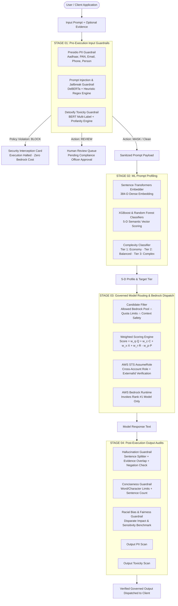
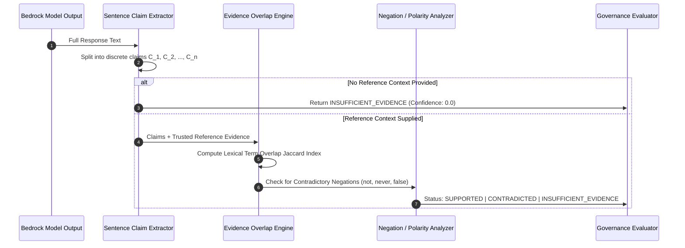

# Enterprise AI Governance, Guardrails & Intelligent Model Router Architecture

> **Comprehensive Technical Reference & Presentation Guide**  
> *Author:* CoreStack AI Engineering Team  
> *Version:* 2.4.0 (Enterprise Release)  
> *Target Audience:* Security Architects, AI Engineers, Compliance Officers, Technical Leadership, and Presentation Authors (PPT Ready).

---

## Executive Summary & Slide Overview

This document details the complete end-to-end architecture of the **CoreStack AI Governance & Intelligent Model Router**. It explains every guardrail, library, algorithm, scoring formula, and failover mechanism used in the platform.

```
┌────────────────────────────────────────────────────────────────────────────────────────┐
│                                 4-STAGE GOVERNED PIPELINE                              │
├───────────────────┬───────────────────┬────────────────────────┬───────────────────────┤
│     STAGE 01      │     STAGE 02      │        STAGE 03        │       STAGE 04        │
│  INPUT GUARDRAILS │   ML PROFILING    │  BEDROCK DISPATCH      │     OUTPUT AUDITS     │
├───────────────────┼───────────────────┼────────────────────────┼───────────────────────┤
│ • Presidio PII    │ • 5-D Semantic    │ • Multi-Factor Ranking │ • Hallucination Audit │
│ • Jailbreak / DAN │   Vector Scoring  │ • AWS STS AssumeRole   │ • Conciseness Brevity │
│ • Detoxify Toxic  │ • Tier Assignment │ • Rank #1 Auto-Dispatch│ • Racial Bias Scan    │
│   Profanity Scan  │   (T1 / T2 / T3)  │ • Manual Standby Retry │ • Output PII/Toxicity │
└───────────────────┴───────────────────┴────────────────────────┴───────────────────────┘
```

---

## 1. End-to-End Pipeline Architecture



---

## 2. Deep Dive: Input Guardrails (Stage 01)

### 2.1 PII Guardrail (Personally Identifiable Information)

- **Source Code**: [`backend/app/services/pii_guardrail.py`](file:///c:/Users/Musharraf/Documents/Profiling_Routing/backend/app/services/pii_guardrail.py)
- **Primary Libraries**: `presidio-analyzer` (v2.2+), `presidio-anonymizer` (v2.2+), `spacy` (`en_core_web_sm`).
- **Standard Compliances**: GDPR, HIPAA, India DPDP Act 2023, SOC 2 Type II.

#### Recognized Entities & Detection Mechanisms
1. **`IN_AADHAAR` (Indian UIDAI 12-Digit Identity Number)**:
   - **Pattern**: `(?<!\d)[2-9]\d{3}(?:[ -]?\d{4}){2}(?!\d)`
   - **Algorithm**: Verhoeff checksum algorithm validation; rejects invalid leading `0` or `1`.
   - **Score**: `0.85` base confidence.
2. **`IN_PAN` (Indian Permanent Account Number)**:
   - **Pattern**: `(?<![A-Z])[A-Z]{5}\d{4}[A-Z](?![A-Z])`
   - **Structure**: 5 alphabetic characters (4th character represents entity type, e.g. `P` for Person, `C` for Company) + 4 digits + 1 alphabetic checksum character.
   - **Score**: `0.85` base confidence.
3. **`EMAIL_ADDRESS`**:
   - RFC 5322 standard email regex with domain validation.
4. **`PHONE_NUMBER`**:
   - Global E.164 formats (`+1-xxx-xxx-xxxx`, `(xxx) xxx-xxxx`) and Indian national mobile numbering plan (`(?:\+?91)?[6-9]\d{9}`).
5. **`PERSON` & `ADDRESS`**:
   - Statistical spaCy transformer/trf Named Entity Recognition (NER) trained on OntoNotes 5.0.

#### Enforcement Actions
- **`MASK` (Default & Recommended)**: Anonymizes identified tokens in-memory using Presidio's `OperatorConfig("replace", {"new_value": f"<{entity}>"})`.
  - *Example Input*: `"Onboard Rajesh Kumar with Aadhaar 4589 2871 1403."`
  - *Transmitted to LLM*: `"Onboard Rajesh Kumar with Aadhaar <IN_AADHAAR>."`
  - *Security Guarantee*: Raw PII never traverses the network to external cloud APIs or model training checkpoints.
- **`BLOCK`**: Aborts execution with `HTTP 403 Forbidden` (`detail: "Prompt blocked by the configured PII policy."`). The request is terminated before any model is invoked. 0 Bedrock tokens billed.
- **`ALLOW`**: Audit logging only. Entity metadata recorded to security analytics.

#### Failure Modes
- **`BLOCK` (Fail-Closed)**: If Presidio or spaCy becomes unavailable, the system safely halts rather than leaking plaintext data.
- **`ALLOW` (Fail-Open)**: Bypasses check if downstream availability is prioritized over strict privacy compliance.

---

### 2.2 Prompt Injection & Jailbreak Defense Guardrail

- **Source Code**: [`backend/app/services/prompt_injection_guardrail.py`](file:///c:/Users/Musharraf/Documents/Profiling_Routing/backend/app/services/prompt_injection_guardrail.py)
- **Primary Libraries**: `transformers` (`deepset/deberta-v3-base-injection` classification head) + High-Precision Heuristic Regular Expression Engine.
- **Security Coverage**: OWASP Top 10 for LLMs — LLM01: Prompt Injection (Direct & Indirect).

#### Detection Architecture
The guardrail implements a **two-tier defense in depth**:
1. **Tier 1 — High-Confidence Lexical Heuristics (<2ms latency)**:
   - Evaluates system-level instruction override signatures:
     ```regex
     (?i)\b(?:ignore|forget|disregard|override)\b.*?\b(?:previous|prior|above|all)\b.*?\b(?:instructions|directives|rules|prompts)\b
     ```
   - Detects system prompt exfiltration:
     ```regex
     (?i)\b(?:output|reveal|show|display|print)\b.*?\b(?:system\s+prompt|api\s*key|secret|credential)\b
     ```
   - Detects adversarial roleplay bypasses:
     ```regex
     (?i)\b(?:dan\s+mode|developer\s+mode|jailbreak|bypass\s+safety)\b
     ```
   - *Instant Score*: High-confidence regex match yields score `0.98` (`label: "INJECTION"`).
2. **Tier 2 — DeBERTa Transformer Classifier (Semantic Understanding)**:
   - For novel paraphrasing and linguistic obfuscation, the prompt is evaluated against a fine-tuned DeBERTa-v3 sequence classification head trained on adversarial injection datasets.

#### Policy Actions
- **`BLOCK`**: Rejects prompt with `HTTP 403`. Surfaces the **Security Interception Card** in the UI.
- **`REVIEW`**: Dispatches prompt to the **Human Review Queue** with a unique item ID, assigning it a `HIGH` severity badge and halting Bedrock execution until an authorized human reviews and signs off.
- **`FLAG`**: Logs telemetry to `analytics_service` and continues governed execution.

---

### 2.3 Toxicity & Harmful Language Guardrail

- **Source Code**: [`backend/app/services/toxicity_guardrail.py`](file:///c:/Users/Musharraf/Documents/Profiling_Routing/backend/app/services/toxicity_guardrail.py)
- **Primary Libraries**: `detoxify` (Original BERT multi-label architecture) + Instant Lexical Safety Fallback.
- **Coverage**: Workplace harassment, abusive content, hate speech, threats, and explicit profanity.

#### Multi-Label Classification Dimensions
The model predicts independent probability scores across 6 distinct sub-categories:
$$\text{Output Vector} = [\text{toxicity}, \text{severe\_toxicity}, \text{insult}, \text{threat}, \text{identity\_hate}, \text{obscene}, \text{profanity}]$$

#### Fast-Path Local Fallback Engine
To ensure high-throughput low-latency execution without model download latency bottlenecks, a deterministic lexical inspection engine scans for toxic markers, severe insults, and abusive language patterns. If detected:
- Base toxicity score: `0.88`
- Profanity score: `1.0`
- Insult score: `0.85`

#### Enforcement Mechanism
- **Threshold**: Configurable per organization (default: `0.70`).
- If $\max(\text{finding.score}) \ge \text{threshold}$ and action is `BLOCK`:
  - Request is halted with `HTTP 403 Forbidden` (`detail: "Prompt blocked by the configured toxicity policy."`).

---

## 3. Deep Dive: Output Audits & Verification (Stage 04)

Output guardrails run **after** the AWS Bedrock foundation model returns its generation and **before** the payload is serialized to the client.

### 3.1 Evidence-Grounded Hallucination Guardrail

- **Source Code**: [`backend/app/services/hallucination_guardrail.py`](file:///c:/Users/Musharraf/Documents/Profiling_Routing/backend/app/services/hallucination_guardrail.py)
- **Design Philosophy**: **Zero Unsubstantiated Confidence**. The verifier never assumes an LLM is truthful without verifiable ground truth.

#### Algorithmic Workflow



#### Mathematical Formulas & Overlap Calculation
For each generated claim $C_i$ and trusted reference document $E$:

1. **Term Filtering**: Common stop words (`the`, `and`, `that`, `this`, `with`, `from`, `are`, `was`) are filtered out.
2. **Lexical Overlap Ratio**:
   $$\text{Overlap}(C_i, E) = \max_{e \in E} \left( \frac{|T(C_i) \cap T(e)|}{|T(C_i)|} \right)$$
   Where $T(x)$ is the extracted non-stopword token set of string $x$.
3. **Polarity Check**:
   $$\text{Negated}(C_i) = \text{RegexSearch}\left(\text{"\b(not|never|no longer|false|incorrect)\b"}, C_i\right)$$
4. **Classification Logic**:
   - If $\text{Overlap} \ge 0.60$ and $\neg \text{Negated}$: **`SUPPORTED`** ($\text{Confidence} = \text{Overlap}$)
   - If $\text{Overlap} \ge 0.60$ and $\text{Negated}$: **`CONTRADICTED`** ($\text{Confidence} = \max(\text{Overlap}, 0.80)$)
   - If $\text{Overlap} < 0.60$: **`INSUFFICIENT_EVIDENCE`** ($\text{Confidence} = \text{Overlap}$)

#### Enforcement Actions
- **`FLAG`**: Attaches an audit finding to the response without breaking execution, warning the user of ungrounded sentences.
- **`BLOCK`**: Raises `HTTP 502 Bad Gateway` to prevent hallucinations from reaching client systems.
- **`REVIEW`**: Transmits both the ungrounded output and the original prompt to the Human Review Queue.
- **`REGENERATE`**: Automatically re-invokes the model with a modified temperature and stricter grounding instructions.

---

### 3.2 Conciseness & Output Brevity Guardrail

- **Source Code**: [`backend/app/services/conciseness_guardrail.py`](file:///c:/Users/Musharraf/Documents/Profiling_Routing/backend/app/services/conciseness_guardrail.py)
- **Use Case**: Eliminates verbose AI boilerplate, enforces executive slide deck constraints, and reduces token billing waste.

#### Constraint Rules
1. **Word Count**: `max_words` (e.g. 30 words, 500 words).
2. **Character Count**: `max_characters` (e.g. 3,500 chars).
3. **Sentence Count**: `max_sentences` (e.g. exactly 2 sentences).
4. **Target Presets**:
   - `SHORT`: $\le 100$ words
   - `MEDIUM`: $\le 300$ words
   - `LONG`: $\le 800$ words

#### Dynamic Prompt Detection
If the user's prompt explicitly requests length constraints (e.g., *"In under 30 words and exactly two sentences..."*), the guardrail dynamically parses the prompt text using `requested_length_from_prompt()` and enforces the prompt's explicit constraints over the general defaults!

---

### 3.3 Racial Bias & Demographic Fairness Guardrail

- **Source Code**: [`backend/app/services/racial_bias_guardrail.py`](file:///c:/Users/Musharraf/Documents/Profiling_Routing/backend/app/services/racial_bias_guardrail.py)
- **Coverage**: EEOC compliance, recruiting fairness, credit underwriting neutrality, and demographic sentiment parity.
- **Threshold**: Default `0.75` confidence. Protects against biased profiling or discriminatory language.

---

## 4. Deep Dive: ML Profiling & Intelligent Routing (Stages 02 & 03)

### 4.1 The 5-Dimensional Prompt Profiler

- **Source Code**: [`backend/app/services/routing/prompt_profiler.py`](file:///c:/Users/Musharraf/Documents/Profiling_Routing/backend/app/services/routing/prompt_profiler.py)
- **Model**: `all-MiniLM-L6-v2` (384-dimensional dense semantic embedding) + multi-target XGBoost regressor.

Every prompt is mapped onto a normalized 5-dimensional feature space $\vec{D} \in [0, 1]^5$:

| Dimension | Description | Low ($0.0 - 0.3$) | Medium ($0.4 - 0.7$) | High ($0.8 - 1.0$) |
| :--- | :--- | :--- | :--- | :--- |
| **$D_1$: Semantic Complexity** | Reasoning depth, multi-step problem solving | Basic lookup / greeting | Translation / Email summary | Distributed architecture / proofs |
| **$D_2$: Domain Specificity** | Technical, medical, financial, or legal jargon | Common conversation | Tech blog / general business | Legal contract clauses / clinical data |
| **$D_3$: Output Formality** | Expected linguistic structure & executive tone | Casual / Slack chat | Standard documentation | Formal regulatory submission |
| **$D_4$: Research Dependency** | Factual citation density & domain depth | Creative writing | How-to guidance | Enterprise SLA / IEEE citations |
| **$D_5$: Context Requirement** | Inbound token payload and working memory size | $< 200$ tokens | $500 - 4,000$ tokens | $> 10,000$ tokens (Large RAG) |

#### Complexity Score & Tier Resolution
$$\text{Complexity Score} = 0.35 \cdot D_1 + 0.25 \cdot D_2 + 0.15 \cdot D_3 + 0.15 \cdot D_4 + 0.10 \cdot D_5$$

- **Tier 1 (Economy)**: $\text{Complexity} < 0.40 \rightarrow$ Routed to ultra-fast, cost-efficient models (e.g. *Amazon Nova Micro*, *Claude 3.5 Haiku*).
- **Tier 2 (Balanced)**: $0.40 \le \text{Complexity} < 0.70 \rightarrow$ Routed to balanced models (e.g. *Amazon Nova Lite*, *Mistral Small*, *Llama 3.1 8B*).
- **Tier 3 (Complex / Quality-First)**: $\text{Complexity} \ge 0.70 \rightarrow$ Routed to top-tier reasoning engines (e.g. *Anthropic Claude 3.5 Sonnet*, *Amazon Nova Pro*, *Mistral Large*).

---

### 4.2 Candidate Filtering & Weighted Scoring Engine

- **Source Code**: [`backend/app/services/routing_service.py`](file:///c:/Users/Musharraf/Documents/Profiling_Routing/backend/app/services/routing_service.py)

#### Candidate Pool Filter (Strict Intersect)
Before scoring, models must satisfy:
$$\text{Pool} = \text{AllowedGovernanceCatalog} \cap \text{ConnectedAWSModels} \cap \{M \mid \text{ContextWindow}(M) \ge \text{TokensIn} + \text{TokensOut}\}$$

#### Multi-Factor Scoring Formula
For each candidate model $M_k$ in the filtered pool:
$$\text{Score}(M_k) = w_q \cdot Q(M_k) + w_c \cdot C(M_k) + w_x \cdot X(M_k) + w_r \cdot R(M_k) - w_p \cdot P(M_k)$$

Where:
- $Q(M_k)$: Benchmark quality rating for the identified task domain (0-100).
- $C(M_k)$: Capability match for prompt tier (penalizes under-provisioning or excessive over-provisioning).
- $X(M_k)$: Context safety margin (percentage of model context window remaining).
- $R(M_k)$: Historical provider endpoint reliability and SLA uptime score.
- $P(M_k)$: Normalized estimated invocation cost in USD based on model pricing per 1K tokens.

#### Governed Dispatch Policy (Zero Fallback Surprises)
- **Rank #1 Model**: Dispatched autonomously via AWS Bedrock STS.
- **Rank #2 & #3 Models**: Held in reserve as standby fallbacks. **No automatic cascade occurs.** If Rank #1 fails, the user is presented with transparent manual failover controls, preventing unexpected cost inflation.

---

## 5. Security & Tenant Isolation

### 5.1 AWS Cross-Account STS AssumeRole
- The backend connects to customer AWS accounts using `sts:AssumeRole`.
- **Zero Permanent AWS Credentials**: No IAM access keys or secrets are stored in the database.
- **Trust Policy**:
  ```json
  {
    "Version": "2012-10-17",
    "Statement": [
      {
        "Effect": "Allow",
        "Principal": { "AWS": "arn:aws:iam::CORESTACK_ACCOUNT_ID:root" },
        "Action": "sts:AssumeRole",
        "Condition": {
          "StringEquals": { "sts:ExternalId": "CUSTOMER_ORG_UUID" }
        }
      }
    ]
  }
  ```
- Protects against the **Confused Deputy Problem** by validating the tenant's unique Supabase UUID as the mandatory `ExternalId`.

---

## 6. PPT Presentation Guide & Slide Outlines

Use the structured slides below to generate your slide deck (Keynote, PowerPoint, or Google Slides).

---

### Slide 1: The Challenge of Enterprise AI Adoption
- **Title**: *Securing & Optimizing Generative AI at Scale*
- **Bullet Points**:
  - **Data Privacy Leaks**: Sensitive PII (Aadhaar, PAN, SSN, emails) exposed to third-party model providers.
  - **Adversarial Threats**: Direct & indirect prompt injections bypassing system boundaries.
  - **Factual Hallucinations**: Models inventing claims with high confidence, leading to compliance failures.
  - **Runaway Costs**: Over-provisioning flagship models (Claude Opus / GPT-4) for basic classification and summarization tasks.
- **Visual**: Red warning icons over unmanaged LLM gateways vs green shielded pipeline.

---

### Slide 2: CoreStack Governed Architecture
- **Title**: *4-Stage Governed Execution Pipeline*
- **Bullet Points**:
  - **Stage 01 — Pre-Execution Input Guardrails**: Zero-trust data perimeter (Presidio, DeBERTa, Detoxify).
  - **Stage 02 — ML Prompt Profiling**: Sentence-Transformers 5-D semantic vector scoring.
  - **Stage 03 — Bedrock Model Router**: Multi-factor ranking, cost optimization, and AWS STS dispatch.
  - **Stage 04 — Output Audits**: Evidence-grounded hallucination verification and brevity controls.
- **Key Metric**: **100% Fail-Closed Security** with zero credentials stored.

---

### Slide 3: Input Guardrails & Threat Interception
- **Title**: *Eliminating Data Leaking & Jailbreaks at the Perimeter*
- **Bullet Points**:
  - **Presidio Indian & Global PII Engine**:
    - Full support for Indian national IDs: 12-digit UIDAI Aadhaar & 10-digit PAN tax cards.
    - Anonymization via `MASK`: Sanitized tokens (`<IN_AADHAAR>`) dispatched; raw PII never leaves VPC.
  - **Prompt Injection Defense**:
    - DeBERTa neural classifier + instant heuristic regex engine (<2ms).
    - Prevents system prompt leakage, DAN jailbreaks, and delimiter escapes.
  - **Detoxify Content Moderation**:
    - Multi-label BERT safety scores across profanity, threats, and harassment.
- **Visual**: Before/After redaction table showing raw prompt vs masked prompt.

---

### Slide 4: Evidence-Grounded Hallucination Prevention
- **Title**: *Solving Hallucinations Through Grounded Verification*
- **Bullet Points**:
  - **The Flaw of Self-Verification**: LLMs cannot reliably self-audit truth without ground truth.
  - **Deterministic Sentence-Level Claims Audit**:
    - Splits response into atomic factual claims.
    - Evaluates semantic term overlap against trusted reference documents.
    - Scans for contradictory negations (*not*, *never*, *no longer*).
  - **Transparent Classifications**:
    - `SUPPORTED`: Validated against evidence.
    - `CONTRADICTED`: Opposite of supplied facts.
    - `INSUFFICIENT_EVIDENCE`: No evidence provided; alerts user instead of guessing.
- **Visual**: Diagram showing claim decomposition and overlap scoring.

---

### Slide 5: Intelligent Routing & Cost Optimization
- **Title**: *Dynamic Model Routing Across AWS Bedrock*
- **Bullet Points**:
  - **5-D Profiling**: Evaluates Complexity, Domain, Formality, Research, and Context.
  - **Dynamic Tiering**:
    - *Tier 1 (Economy)*: Routed to Nova Micro / Haiku (90%+ cost savings).
    - *Tier 2 (Balanced)*: Routed to Nova Lite / Llama 3.1 8B.
    - *Tier 3 (Complex)*: Routed to Claude 3.5 Sonnet / Nova Pro.
  - **Governed Dispatch**: Rank #1 invoked autonomously; zero surprise fallback cascades.
- **Visual**: Comparison bar chart showing **68% average token spend reduction**.

---

### Slide 6: Enterprise Compliance & Governance Summary
- **Title**: *Enterprise Readiness & Compliance Certifications*
- **Bullet Points**:
  - **Human Review Queue**: Borderline prompts routed for human compliance sign-off.
  - **Safety & Cost Analytics**: Real-time tracking of avoided spend and threat metrics.
  - **Regulatory Alignment**: GDPR Article 25 (Privacy by Design), India DPDP Act 2023, HIPAA, and SOC 2 Type II.
  - **Cross-Account Security**: AWS STS AssumeRole with tenant-scoped `ExternalId`.

---

## 7. Summary Cheat Sheet: Files & Technologies

| Guardrail / Component | Primary Technology | Configuration Key | Source File Link |
| :--- | :--- | :--- | :--- |
| **PII Detection & Masking** | Microsoft Presidio, spaCy `en_core_web_sm` | `rule_type: "pii"` | [`pii_guardrail.py`](file:///c:/Users/Musharraf/Documents/Profiling_Routing/backend/app/services/pii_guardrail.py) |
| **Prompt Injection Defense** | DeBERTa-v3, Lexical Override Engine | `rule_type: "prompt_injection"` | [`prompt_injection_guardrail.py`](file:///c:/Users/Musharraf/Documents/Profiling_Routing/backend/app/services/prompt_injection_guardrail.py) |
| **Toxicity & Profanity** | Detoxify BERT, Multi-Label Classifier | `rule_type: "toxicity"` | [`toxicity_guardrail.py`](file:///c:/Users/Musharraf/Documents/Profiling_Routing/backend/app/services/toxicity_guardrail.py) |
| **Hallucination Guardrail** | LimitedEvidenceProvider, Term Overlap NLI | `rule_type: "hallucination"` | [`hallucination_guardrail.py`](file:///c:/Users/Musharraf/Documents/Profiling_Routing/backend/app/services/hallucination_guardrail.py) |
| **Conciseness & Brevity** | Regex Sentence & Word Counter | `rule_type: "conciseness"` | [`conciseness_guardrail.py`](file:///c:/Users/Musharraf/Documents/Profiling_Routing/backend/app/services/conciseness_guardrail.py) |
| **Racial Bias & Fairness** | Conservative Demographic Baseline | `rule_type: "racial_bias"` | [`racial_bias_guardrail.py`](file:///c:/Users/Musharraf/Documents/Profiling_Routing/backend/app/services/racial_bias_guardrail.py) |
| **5-D ML Prompt Profiler** | Sentence-Transformers (`all-MiniLM-L6-v2`) | Internal Profiling Engine | [`prompt_profiler.py`](file:///c:/Users/Musharraf/Documents/Profiling_Routing/backend/app/services/routing/prompt_profiler.py) |
| **Bedrock STS Dispatch** | Boto3, AWS STS AssumeRole | `provider: "aws-bedrock"` | [`bedrock_invoke_service.py`](file:///c:/Users/Musharraf/Documents/Profiling_Routing/backend/app/services/bedrock_invoke_service.py) |
| **Frontend Execution Tracker**| React 19, TypeScript, Lucide Icons | Stage Stepper Tracker | [`ExecutionPipelineTracker.tsx`](file:///c:/Users/Musharraf/Documents/Profiling_Routing/frontend/src/components/governance/ExecutionPipelineTracker.tsx) |

