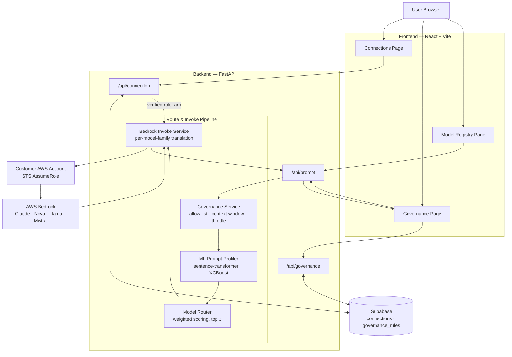

# AI Profiling & Routing Platform

A multi-provider AI governance platform that enables secure cloud provider connections, intelligent prompt profiling, governed model routing, and cost-aware dispatch across AWS Bedrock foundation models.

## Project Structure

```
Profiling_Routing/
├── frontend/                       # React + TypeScript + Vite
│   └── src/
│       ├── components/
│       │   ├── connections/        # AWS Bedrock connect + IAM role test flow
│       │   ├── governance/         # Single production page: guardrails, prompt, routing, retry
│       │   └── models/             # Read-only Bedrock model registry browser (grouped by provider)
│       └── services/               # apiService.ts (real backend calls), mockService.ts (thin wrapper)
├── backend/                         # Python FastAPI
│   ├── app/
│   │   ├── config.py                # Settings & environment variables (loads .env)
│   │   ├── schemas.py                # Pydantic request/response models
│   │   ├── routes/
│   │   │   ├── connection.py         # /api/connection endpoints
│   │   │   ├── prompt.py             # /api/prompt endpoints (profile, route+invoke, catalog)
│   │   │   └── governance.py         # /api/governance endpoints (rule CRUD)
│   │   └── services/
│   │       ├── aws_service.py        # STS AssumeRole + Bedrock ListFoundationModels
│   │       ├── supabase_service.py   # Per-user connection persistence
│   │       ├── governance_service.py # Governance rule evaluation + throttle tracking
│   │       ├── model_mapping_service.py  # Friendly-ID <-> Bedrock-model-ID mapping
│   │       ├── bedrock_invoke_service.py # Per-model-family InvokeModel request/response translation
│   │       ├── routing_service.py    # Singleton facade over the ML routing engine
│   │       ├── pii_guardrail.py      # Presidio PII detection/masking
│   │       ├── toxicity_guardrail.py # Local toxicity and profanity checks
│   │       ├── prompt_injection_guardrail.py # Prompt-injection classifier seam
│   │       ├── hallucination_guardrail.py # Evidence-aware verification seam
│   │       ├── conciseness_guardrail.py # Deterministic response-size checks
│   │       ├── racial_bias_guardrail.py # Conservative fairness baseline
│   │       └── routing/              # Prompt profiler (sentence-transformer + XGBoost) + model registry
│   ├── cloudformation/
│   │   └── bedrock-role-template.yaml  # IAM Role CloudFormation template
│   ├── tests/
│   └── main.py                      # FastAPI app entrypoint
└── team_task_specs.md                # Capstone project specifications
```

## Architecture



Rank #1 from the router is invoked automatically; if it fails, the UI surfaces a manual retry for rank #2/#3 — there is no automatic fallback cascade.

## Features

- **Supabase Authentication** — Email/password sign-up and sign-in, with a local dev-mode fallback
- **AWS Bedrock Connection** — Secure cross-account IAM role assumption via STS with ExternalId verification
- **CloudFormation Template** — One-click IAM role deployment for customers connecting their AWS accounts
- **Prompt Profiling & Intelligent Routing** — ML-scored complexity/domain/intent, ranks the top 3 allowed models by cost/quality/context fit
- **Governance Guardrails** — Per-org allow-list (real Bedrock model IDs), context-window limits, throttling/daily quotas, `dry_run`/`enforce` modes
- **Governed Dispatch, No Auto-Fallback** — Rank #1 is invoked automatically; rank #2/#3 are only invoked if you manually retry
- **Model Registry Browser** — Maintained catalog of Bedrock models, grouped by provider with brand icons

### Guardrail release notes

The current branch includes six independent, tenant-scoped output/input
guardrails: PII, toxicity, prompt injection, hallucination, conciseness, and
racial bias. Every guardrail is disabled unless an organization saves an
enabled governance rule. Providers are isolated behind small interfaces so a
future classifier or service can replace a local baseline without changing the
route contract.

The production response path is:

```text
Supabase identity -> AWS connection -> input PII/toxicity/injection checks
-> governance/profile/routing -> AWS Bedrock -> output PII/toxicity checks
-> hallucination -> conciseness -> racial-bias checks -> structured response
```

Output policies never log complete prompts or responses by default. `FLAG`
returns structured metadata, `BLOCK` prevents the response, `REVIEW` blocks
because no human review queue exists, and `REGENERATE` is limited to one
retry followed by re-evaluation. Detector confidence is advisory and does
not prove factual correctness, toxicity, or discrimination.

## Getting Started

### Prerequisites

- **Node.js** ≥ 18
- **Python** ≥ 3.12
- **AWS Account** with Bedrock access
- **Supabase Project**

### Backend Setup

```bash
cd backend
pip install -r requirements.txt

# Copy .env.example to .env and fill in your credentials
cp .env.example .env

# Run the server
python -m uvicorn main:app --reload --port 8000
```

> **Note:** `requirements.txt` includes ML dependencies (`torch`, `sentence-transformers`, `xgboost`) needed for prompt profiling — installed footprint is ~2-3GB. First startup downloads the `BAAI/bge-base-en-v1.5` embedding model from Hugging Face and can take 10-30s.

### PII Guardrail Setup (Optional)

The active routing pipeline can scan prompts before profiling/routing and model
responses before they are returned. It uses Presidio in-process; it does not
expose a Presidio endpoint publicly. The guardrail is disabled until an
organization creates a `pii` governance rule.

On Windows PowerShell, install the packages and English model with:

```powershell
Set-Location .\backend
py -3.12 -m pip install -r requirements.txt
py -3.12 -m spacy download en_core_web_sm
```

Create a `pii` rule through the Governance page or API. Example configuration:

```json
{
  "rule_type": "pii",
  "scope": "org",
  "config": {
    "enabled": true,
    "scan_input": true,
    "scan_output": true,
    "action": "MASK",
    "failure_mode": "BLOCK",
    "entities": ["EMAIL_ADDRESS", "PHONE_NUMBER", "PERSON", "ADDRESS", "IN_AADHAAR", "IN_PAN"],
    "score_threshold": 0.35
  },
  "mode": "enforce"
}
```

Supported actions are `ALLOW`, `MASK`, and `BLOCK`. `failure_mode` controls
what happens if Presidio is unavailable or returns an invalid result; use
`BLOCK` for fail-closed behavior. Detection is not complete coverage: results
depend on Presidio recognizers, language/model support, configured entities,
and confidence threshold. Raw detected values are not returned or logged by
the guardrail.

Run the backend and frontend from separate PowerShell terminals:

```powershell
Set-Location .\backend
py -3.12 -m uvicorn main:app --reload --port 8000

Set-Location .\frontend
npm run dev
```

### Frontend Setup

```bash
cd frontend
npm install

# Copy .env.example to .env and fill in your Supabase + backend URL
cp .env.example .env

# Run the dev server
npm run dev
```

### Supabase Database Setup

Run the following SQL in the Supabase SQL Editor:

```sql
CREATE TABLE public.connections (
  id uuid NOT NULL DEFAULT gen_random_uuid(),
  user_id uuid NOT NULL,
  external_id uuid NOT NULL,
  role_arn text,
  status text NOT NULL DEFAULT 'pending'::text,
  available_models jsonb DEFAULT '[]'::jsonb,
  error text,
  verified_at timestamp with time zone,
  last_synced_at timestamp with time zone,
  created_at timestamp with time zone DEFAULT now(),
  updated_at timestamp with time zone DEFAULT now(),
  CONSTRAINT connections_pkey PRIMARY KEY (id),
  CONSTRAINT connections_user_id_unique UNIQUE (user_id),
  CONSTRAINT connections_user_id_fkey FOREIGN KEY (user_id) REFERENCES auth.users(id) ON DELETE CASCADE
);

ALTER TABLE public.connections ENABLE ROW LEVEL SECURITY;

CREATE POLICY "Allow backend all access connections"
  ON public.connections FOR ALL USING (true) WITH CHECK (true);

CREATE TABLE public.governance_rules (
  id uuid NOT NULL DEFAULT gen_random_uuid(),
  org_id uuid NOT NULL,
  rule_type text NOT NULL,   -- 'allow_list' | 'throttle' | 'context_window' | 'pii' | 'toxicity' | 'prompt_injection'
  scope text NOT NULL DEFAULT 'org',
  scope_target text,
  config jsonb NOT NULL DEFAULT '{}'::jsonb,
  mode text NOT NULL DEFAULT 'dry_run',   -- 'dry_run' | 'enforce'
  created_at timestamptz DEFAULT now(),
  updated_at timestamptz DEFAULT now(),
  CONSTRAINT governance_rules_pkey PRIMARY KEY (id)
);

CREATE UNIQUE INDEX governance_rules_org_type_scope
  ON public.governance_rules(org_id, rule_type, scope, coalesce(scope_target, ''));

ALTER TABLE public.governance_rules ENABLE ROW LEVEL SECURITY;

CREATE POLICY "Allow backend all access governance_rules"
  ON public.governance_rules FOR ALL USING (true) WITH CHECK (true);
```

> If this table is missing or unreachable, the backend transparently falls back to sensible in-memory default rules (allow-list = full maintained catalog, context window 200K/8192/250K, throttle 60rpm/5M tokens-per-day) so the app still works without it — but rule changes won't persist across restarts until the table exists.

### AWS CloudFormation Setup

1. Deploy `backend/cloudformation/bedrock-role-template.yaml` in your target AWS account
2. Set `TrustedAccountId` to your platform's AWS Account ID
3. Set `ExternalId` to the user's Supabase Auth UUID (shown on the Connections page)
4. Copy the output `RoleArn` and paste it into the Connections page
5. **Enable model access** for the Bedrock models you want invokable, in the AWS Bedrock console (Model access) — this is a separate, per-account gate from IAM permissions and isn't something the app can toggle for you

## API Endpoints

| Method | Endpoint | Description |
|--------|----------|-------------|
| `GET` | `/api/connection` | Get connection status for user |
| `POST` | `/api/connection/test` | Test AWS Bedrock connection |
| `POST` | `/api/connection/reset` | Reset connection to disconnected |
| `GET` | `/api/connection/models` | Get available Bedrock models |
| `GET` | `/api/prompt/catalog` | Get the maintained Bedrock model catalog |
| `POST` | `/api/prompt/profile` | Profile + route a prompt without invoking (requires verified connection) |
| `POST` | `/api/prompt/route` | Full pipeline: governance → profile → route → invoke rank #1 (or a validated `retry_bedrock_model_id`) |
| `GET` | `/api/governance/rules` | Get configured governance rules for the org |
| `POST` | `/api/governance/rules` | Upsert a governance rule (`allow_list` \| `context_window` \| `throttle` \| `pii` \| `toxicity` \| `prompt_injection` \| `hallucination` \| `conciseness` \| `racial_bias`) |
| `GET` | `/api/governance/defaults` | Get default rule templates |
| `GET` | `/health` | Health check |

## Running Tests

```bash
cd backend
python -m pytest -v
```

## Toxicity Detection

Toxicity detection is a separate optional guardrail from PII detection. It
uses the local open-source [Detoxify](https://github.com/unitaryai/detoxify)
model for toxicity, severe toxicity, obscenity, threats, insults, and identity
hate scores. A small configurable profanity lexicon supplements the model
because profanity is not a distinct Detoxify output.

Configure a `toxicity` governance rule with:

```json
{
  "rule_type": "toxicity",
  "mode": "enforce",
  "config": {
    "enabled": true,
    "scan_input": true,
    "scan_output": true,
    "action": "FLAG",
    "score_threshold": 0.7,
    "categories": ["toxicity", "insult", "threat", "identity_hate", "obscene", "profanity"],
    "failure_mode": "BLOCK"
  }
}
```

Actions are `ALLOW`, `FLAG`, `BLOCK`, and `REGENERATE`. `REGENERATE` applies
only to model output; toxic input is rejected because the platform cannot
rewrite a user's intent safely. The implementation performs at most one safe
regeneration attempt and blocks the response if it remains toxic. `FLAG`
continues processing and returns category/score metadata without raw text.

Install on Windows PowerShell:

```powershell
Set-Location .\backend
py -3.12 -m pip install -r requirements.txt
```

The default Detoxify model downloads approximately 418 MB on first use from
the model provider. Detoxify's scores are probabilistic and are not a
complete safety classifier. Context, quotation, educational discussion,
reclaimed language, dialect, and multilingual content can produce false
positives or false negatives. The model and weights are distributed under
their upstream license; review the Detoxify repository and model-card terms
before commercial redistribution. The provider is isolated behind
`ToxicityProvider` so it can be replaced with another local or service-backed
classifier.

## Prompt Injection Detection

Prompt injection detection is a separate optional input guardrail. It uses
the local open-source
[ProtectAI DeBERTa prompt-injection classifier](https://huggingface.co/protectai/deberta-v3-base-prompt-injection-v2)
through Transformers. The provider is isolated behind
`PromptInjectionProvider` so it can be replaced with another local model or a
service-backed classifier.

Configure a `prompt_injection` governance rule:

```json
{
  "rule_type": "prompt_injection",
  "mode": "enforce",
  "config": {
    "enabled": true,
    "scan_input": true,
    "action": "FLAG",
    "score_threshold": 0.8,
    "failure_mode": "BLOCK"
  }
}
```

Actions are `ALLOW`, `FLAG`, `BLOCK`, and `REVIEW`. `FLAG` records category and
score metadata and continues routing. `BLOCK` rejects the prompt. `REVIEW`
also blocks pending review because this application does not currently have a
human-review queue. Model permissions, authorization, and tool permissions
remain separate security controls; a detector is not a substitute for them.

The model is lazy-loaded and downloads on first enabled use:

```powershell
Set-Location .\backend
py -3.12 -m pip install -r requirements.txt
```

The classifier can detect direct attempts to override instructions, reveal
hidden prompts, bypass safety controls, or manipulate model behavior, but it
is probabilistic. Educational, defensive, quoted, multilingual, or novel
attacks may produce false positives or false negatives. Review the upstream
model card and Transformers/model license terms before commercial
redistribution.

This repository currently has no RAG, document-retrieval, tool-result, or
external-content pipeline. Therefore indirect injection scanning is not
silently claimed or applied. If untrusted retrieval is added, it must be
scanned as a separate untrusted-content input and never promoted to trusted
system instructions.

## Hallucination Detection

Hallucination detection is an optional **output** guardrail. The current
platform has no retrieval or evidence store, so the default
`limited_evidence` provider verifies claims only against trusted
`reference_context` supplied with the request. Without that context it returns
`INSUFFICIENT_EVIDENCE`; it never treats missing evidence as proof of
falsehood and never claims an LLM approval is factual verification.

Add a tenant-scoped `hallucination` rule:

```json
{
  "rule_type": "hallucination",
  "mode": "enforce",
  "config": {
    "enabled": true,
    "provider": "limited_evidence",
    "action": "FLAG",
    "confidence_threshold": 0.7,
    "failure_mode": "BLOCK"
  }
}
```

Send trusted evidence explicitly when available:

```json
{
  "prompt": "Summarize the supplied policy.",
  "reference_context": [
    "The policy takes effect on 1 January 2026."
  ]
}
```

Verification statuses are `SUPPORTED`, `CONTRADICTED`,
`INSUFFICIENT_EVIDENCE`, and `REVIEW_REQUIRED`. Findings contain only the
claim text, status, confidence, and explanation. `ALLOW` and `FLAG` return the
response with structured metadata; `BLOCK` rejects questionable output;
`REVIEW` blocks because no human review queue exists; and `REGENERATE` makes
at most one evidence-grounded retry before blocking if the result remains
questionable. Provider failures use the configured failure mode (`BLOCK`,
`REVIEW`, or `ALLOW`).

The verifier is replaceable through `HallucinationProvider`. The built-in
provider is a conservative lexical baseline, not a general fact checker: it
cannot establish truth beyond supplied evidence, may miss paraphrases, and
should not be used as the sole control for high-impact decisions. No external
credentials or model download are required.

## Conciseness Detection

Conciseness is an optional deterministic output guardrail. It measures word,
character, and sentence counts and detects exact repeated sentences. It does
not use an LLM to count or judge length. Configure it as a tenant-scoped
`conciseness` rule:

```json
{
  "rule_type": "conciseness",
  "mode": "enforce",
  "config": {
    "enabled": true,
    "max_words": 500,
    "max_characters": 3500,
    "max_sentences": 20,
    "response_length": "MEDIUM",
    "action": "FLAG",
    "failure_mode": "BLOCK"
  }
}
```

`response_length` supports `SHORT`, `MEDIUM`, and `LONG`, with conservative
default limits. Explicit request wording such as “brief answer”, “medium
length”, or “detailed explanation” takes precedence over the generic default.
Callers may also send `requested_response_length` as `SHORT`, `MEDIUM`, or
`LONG` in `POST /api/prompt/route`.

Actions are `ALLOW`, `FLAG`, `BLOCK`, `REVIEW`, and `REGENERATE`.
`REGENERATE` performs one retry with the findings included in the retry
instruction, then re-evaluates the result. `REVIEW` blocks because the
platform has no human review queue. Empty responses are measured as zero
content. The repetition check only identifies exact normalized sentence
duplicates; semantic repetition and writing quality require a separate
review process.

No installation or external credentials are required. On Windows, install
the existing backend dependencies and run the complete deterministic suite:

```powershell
Set-Location .\backend
py -3.12 -m pip install -r requirements.txt
python -m pytest -q
```

## Racial Bias Detection

Racial bias detection is an optional output guardrail with a conservative,
replaceable provider interface. The built-in
`conservative_baseline` provider does not treat every racial or ethnic
reference as biased. It combines group references with signals for
unsupported generalizations, superiority or dehumanization claims, and
unjustified differential treatment. Educational, historical, quoted, and
anti-discrimination contexts lower detection confidence or remain clear.

Configure a tenant-scoped `racial_bias` rule:

```json
{
  "rule_type": "racial_bias",
  "mode": "enforce",
  "config": {
    "enabled": true,
    "provider": "conservative_baseline",
    "confidence_threshold": 0.75,
    "action": "FLAG",
    "failure_mode": "BLOCK"
  }
}
```

Statuses are `CLEAR`, `POTENTIAL_BIAS`, and `REVIEW_REQUIRED`. Findings include
only a category, confidence, and short explanation; raw response text is not
logged by the guardrail. Actions are `ALLOW`, `FLAG`, `BLOCK`, `REVIEW`, and
`REGENERATE`. Regeneration makes one retry and verifies the revised output
again. `REVIEW` blocks because this platform has no human review queue.

The provider is intentionally a transparent baseline, not a comprehensive
fairness classifier. It can produce false positives for ambiguous, quoted, or
statistical discussion and false negatives for subtle, coded, multilingual, or
context-dependent bias. A confidence score is not proof that discrimination
occurred, and this guardrail does not eliminate racial bias. No new dependency,
credential, or model download is required:

```powershell
Set-Location .\backend
py -3.12 -m pip install -r requirements.txt
python -m pytest -q
```

## PII End-to-End Validation Report

The Presidio guardrail was tested through the real FastAPI prompt-routing
pipeline. Presidio analyzer and anonymizer execution were real; the AWS
Bedrock invocation was mocked because no live AWS account was connected during
validation.

### Validation results

- PII end-to-end tests: **3 passed**
- Full backend test suite: **34 passed, 10 intentionally skipped**
- Backend Python compilation: **passed**
- Git whitespace validation: **passed**

### Behaviors verified

1. Input email and phone values are detected before routing.
2. With `MASK`, input PII is replaced before the model invocation.
3. Output email and PAN values are detected before the API response is returned.
4. With `MASK`, output PII is replaced with entity placeholders.
5. With `BLOCK`, the request is rejected before model invocation.
6. Invalid PII policy configuration returns HTTP `422`.
7. PII metadata contains entity type, count, and confidence only; raw values
   are not returned.

Example verified transformation:

```text
Input:         Contact alice@example.com and call +1 212-555-0100.
Model receives: Contact <EMAIL_ADDRESS> and call <PHONE_NUMBER>.
API output:     Reply to <EMAIL_ADDRESS> with PAN <IN_PAN>.
```

### Live validation limitation

The following live dependencies were not available during this test:

- Supabase authentication, because the configured Supabase hostname was not
  reachable from the test environment.
- AWS Bedrock invocation, because no verified AWS connection was configured.

Consequently, the PII guardrail and its routing integration are verified, but a
production live-flow test still requires valid Supabase authentication and a
verified AWS Bedrock connection.

## Tech Stack

- **Frontend**: React, TypeScript, Vite, Supabase Auth, react-markdown
- **Backend**: Python, FastAPI, Boto3, Pydantic
- **Prompt Profiling**: sentence-transformers (`BAAI/bge-base-en-v1.5`), XGBoost, scikit-learn (PCA/KNN)
- **Database**: Supabase (PostgreSQL)
- **Cloud**: AWS Bedrock, IAM, STS, CloudFormation
